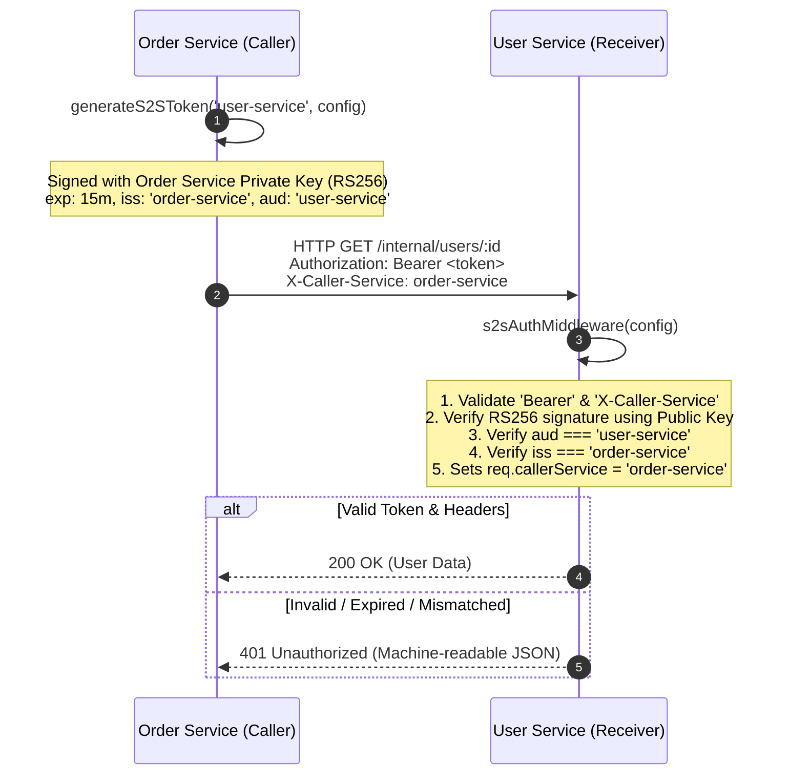

# SpotQ Common (`spotq-common`)

> Shared core utilities, middlewares, and contracts for SpotQ distributed microservices.

[](https://pnpm.io/workspaces)
[](https://www.typescriptlang.org/)
[](#security-architecture)

---

## 1. Overview & Architectural Role

`spotq-common` is the centralized, standalone shared utility repository for the **SpotQ** backend platform. It hosts core enterprise packages shared across all backend microservices:

* **User Service (`spotq-user-service`)**
* **Restaurant Service (`spotq-restaurant-service`)**
* **Order Service (`spotq-order-service`)**
* **Queue Service (`spotq-queue-service`)**

Instead of duplicating security and utility logic across services, `spotq-common` distributes hardened, stateless, and audited packages maintained in a single version-controlled monorepo.

---

## 2. Packages

| Package | Version | Description |
| :--- | :--- | :--- |
| [`@spotq/s2s-core`](./packages/s2s-core) | `1.0.0` | Stateless Service-to-Service (S2S) RS256 JWT issuer & Express verification middleware |

---

## 3. Security Architecture: S2S Authentication (`@spotq/s2s-core`)

Inter-service communication in SpotQ must never rely on perimeter trust (zero-trust network model). Requests between services are cryptographically signed and verified using **Asymmetric RS256 Cryptography**.



### Guiding Principles

1. **Stateless & Pure Design**: Packages in this repository **NEVER read `process.env` directly**. All keys, credentials, and service identifiers must be injected explicitly at runtime by the consuming microservice.
2. **Short-Lived Tokens**: Tokens automatically expire in **15 minutes (`15m`)** to minimize replay windows.
3. **Dual Identity Verification**: The receiver checks both the asymmetric signature, audience claim (`aud`), and validates that the `X-Caller-Service` header matches the token issuer claim (`iss`/`sub`).
4. **Machine-Readable Error Contracts**: All unauthorized requests return consistent, structured JSON responses:
   ```json
   {
     "success": false,
     "statusCode": 401,
     "code": "UNAUTHORIZED_S2S" | "INVALID_S2S_TOKEN",
     "message": "Descriptive reason for rejection",
     "retryable": false
   }
   ```

---

## 4. Repository & Workspace Structure

This repository uses **pnpm workspaces**:

```text
spotq-common/
├── pnpm-workspace.yaml         # Defines packages/* workspace layout
├── package.json                # Monorepo root configuration
├── .gitignore
├── README.md
└── packages/
    └── s2s-core/               # @spotq/s2s-core package
        ├── package.json        # Scoped as @spotq/s2s-core, peer-depends on express
        ├── tsconfig.json       # Strict TypeScript compiler config (outDir: dist)
        └── src/
            ├── issuer.ts       # S2SIssuerConfig & generateS2SToken()
            ├── middleware.ts   # S2SVerifierConfig, s2sAuthMiddleware(), Express type augmentation
            └── index.ts        # Public module exports
```

---

## 5. Consumer Implementation Guide

The following practical examples demonstrate how consumer microservices (e.g., the **Order Service** and **User Service**) integrate `@spotq/s2s-core` by feeding runtime environment variables into the pure functions.

### Step 1: RSA Key Generation (Ops / Infrastructure)

For local development or CI/CD pipelines, generate an RS256 key pair:

```bash
# 1. Generate an RSA 2048-bit Private Key
openssl genrsa -out s2s-private.pem 2048

# 2. Extract the corresponding Public Key
openssl rsa -in s2s-private.pem -pubout -out s2s-public.pem
```

Store these in your secrets manager or service `.env` file (newlines can be escaped as `\n`).

---

### Step 2: Caller Service Example (e.g., Order Service Calling User Service)

The caller service reads its local environment variables at boot/runtime and issues an S2S token when calling downstream microservices:

```typescript
// spotq-order-service/src/infrastructure/clients/user-service.client.ts
import axios from 'axios';
import { generateS2SToken, S2SIssuerConfig } from '@spotq/s2s-core';

// 1. Consumer microservice reads its own environment variables
const S2S_CONFIG: S2SIssuerConfig = {
  serviceName: process.env.SERVICE_NAME || 'order-service',
  privateKey: process.env.S2S_PRIVATE_KEY || '',
};

const USER_SERVICE_BASE_URL = process.env.USER_SERVICE_URL || 'http://localhost:4001';

export class UserServiceClient {
  /**
   * Fetches user profile for order validation using authenticated S2S communication.
   */
  public async getUserById(userId: string) {
    const targetAudience = 'user-service';

    // 2. Generate a 15-minute RS256 token explicitly passing config
    const s2sToken = generateS2SToken(targetAudience, S2S_CONFIG);

    // 3. Attach Bearer token and X-Caller-Service identity header
    const response = await axios.get(`${USER_SERVICE_BASE_URL}/internal/users/${userId}`, {
      headers: {
        Authorization: `Bearer ${s2sToken}`,
        'X-Caller-Service': S2S_CONFIG.serviceName,
      },
      timeout: 5000,
    });

    return response.data;
  }
}
```

---

### Step 3: Receiver Service Example (e.g., User Service Protecting Internal Endpoints)

The receiver service reads its own environment variables and mounts `s2sAuthMiddleware` on internal routes.

```typescript
// spotq-user-service/src/routes/internal-user.routes.ts
import { Router, Request, Response } from 'express';
import { s2sAuthMiddleware, S2SVerifierConfig } from '@spotq/s2s-core';

const router = Router();

// 1. Consumer microservice reads its own verification configuration
const s2sVerifierConfig: S2SVerifierConfig = {
  publicKey: process.env.S2S_PUBLIC_KEY || '',
  expectedAudience: process.env.SERVICE_NAME || 'user-service',
};

// 2. Protect all internal routes using the middleware
router.use('/internal', s2sAuthMiddleware(s2sVerifierConfig));

// 3. Downstream handlers now have access to req.callerService (natively typed!)
router.get('/internal/users/:id', (req: Request, res: Response) => {
  // req.callerService is automatically populated and typed via Express Request augmentation
  console.log(`[Audit] Internal request received from caller: ${req.callerService}`);

  res.json({
    success: true,
    data: {
      id: req.params.id,
      name: 'John Doe',
      caller: req.callerService,
    },
  });
});

export default router;
```

---

## 6. Development & Build Scripts

```bash
# Install all workspace dependencies
pnpm install

# Build all workspace packages
pnpm run build

# Run TypeScript type check across all packages
pnpm run typecheck

# Clean compiled build artifacts
pnpm run clean
```

---

## 7. License & Access

Internal proprietary software for the **SpotQ** organization. Restricted access.
