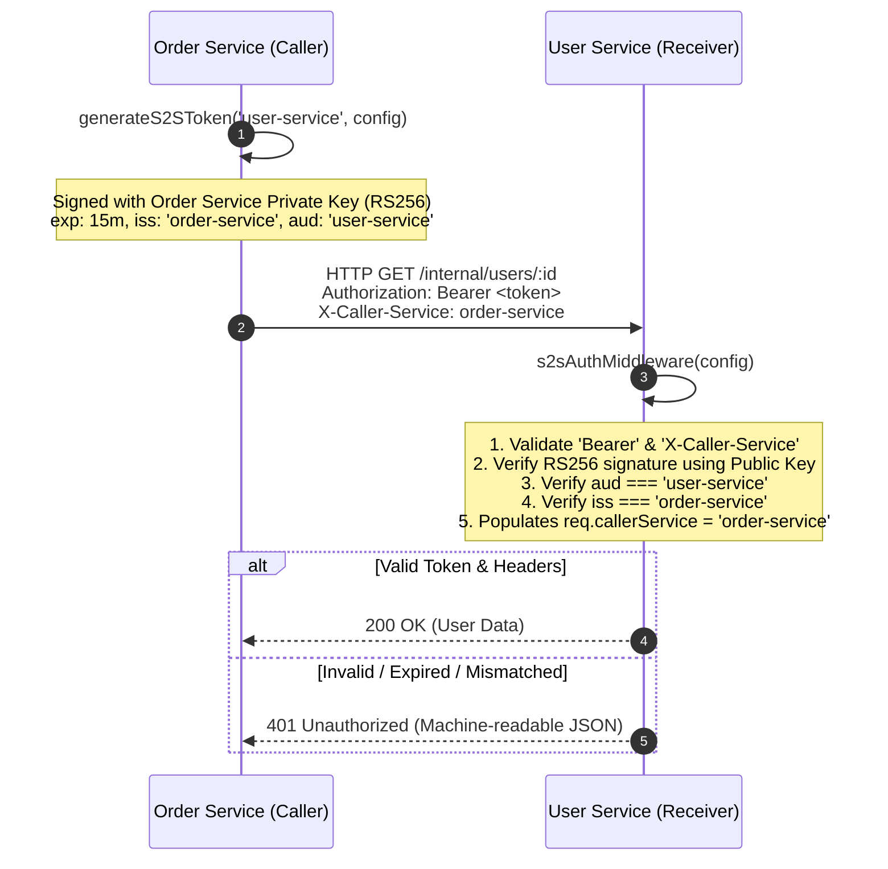

# @spotq-org/s2s-core

> Stateless Service-to-Service (S2S) authentication middleware and token issuer for SpotQ microservices using asymmetric RS256 JWTs.

[](#)
[](https://www.typescriptlang.org/)
[](#security-architecture)

---

## 1. Overview & Architectural Role

`@spotq-org/s2s-core` provides zero-trust, cryptographically verified inter-service communication across SpotQ distributed microservices:

* **User Service (`spotq-user-service`)**
* **Restaurant Service (`spotq-restaurant-service`)**
* **Order Service (`spotq-order-service`)**
* **Queue Service (`spotq-queue-service`)**

Instead of relying on insecure network-perimeter trust or shared static API keys, services sign short-lived JWTs using their private RSA keys. Downstream services verify signatures using the public key and validate that the caller's identity matches the token claims.

---

## 2. Security Architecture



### Guiding Principles

1. **Stateless & Pure Design**: This package **NEVER reads `process.env` directly**. All keys, credentials, and identifiers must be injected explicitly via configuration objects by the consuming microservice.
2. **Short-Lived Expiration**: Tokens expire in **15 minutes (`15m`)** by default (configurable per call) to prevent replay vulnerabilities.
3. **Dual Identity Enforcement**: Verifies both the cryptographic signature and that the `X-Caller-Service` header matches the token's `iss` / `sub` claims.
4. **Machine-Readable Error Contracts**: All unauthorized requests reject with consistent, structured JSON responses:
   ```json
   {
     "success": false,
     "statusCode": 401,
     "code": "UNAUTHORIZED_S2S" | "INVALID_S2S_TOKEN",
     "message": "Descriptive reason for rejection",
     "retryable": false
   }
   ```

---

## 3. Installation

In your consumer microservice (inside the SpotQ workspace):

```bash
pnpm add @spotq-org/s2s-core
```

Ensure `express` is installed in your application as a peer dependency:

```bash
pnpm add express
```

---

## 4. API Reference

### A. Token Issuer (`issuer.ts`)

#### `generateS2SToken(targetAudience: string, config: S2SIssuerConfig): string`

Generates an asymmetric RS256 signed JWT string for invoking downstream microservices.

```typescript
export interface S2SIssuerConfig {
  /** RSA Private Key in PEM format used for signature generation */
  privateKey: string;

  /** Unique identifier of the initiating microservice (e.g. 'order-service') */
  serviceName: string;

  /** Cryptographic algorithm. Defaults to 'RS256' */
  algorithm?: Algorithm;

  /** Token lifetime expression (e.g. '15m', '1h', or numeric seconds). Defaults to '15m' */
  expiresIn?: SignOptions['expiresIn'];
}
```

---

### B. Authentication Middleware (`middleware.ts`)

#### `s2sAuthMiddleware(config: S2SVerifierConfig): RequestHandler`

Express middleware factory that enforces RS256 signature validation and caller identity verification.

```typescript
export interface S2SVerifierConfig {
  /** RSA Public Key in PEM format used for signature verification */
  publicKey: string;

  /** Expected audience identifier matching this recipient service (e.g. 'user-service') */
  expectedAudience: string;

  /** Permitted algorithms for verification. Defaults to ['RS256'] */
  algorithms?: Algorithm[];
}
```

#### Ambient Type Augmentation (`req.callerService`)

When this package is imported, Express's `Request` interface is automatically augmented so that downstream handlers have type-safe access to the verified caller service:

```typescript
declare global {
  namespace Express {
    interface Request {
      callerService: string;
    }
  }
}
```

---

### C. Error Codes & Contracts

```typescript
export const S2S_ERROR_CODES = {
  UNAUTHORIZED_S2S: 'UNAUTHORIZED_S2S',
  INVALID_S2S_TOKEN: 'INVALID_S2S_TOKEN',
} as const;

export type S2SErrorCode = (typeof S2S_ERROR_CODES)[keyof typeof S2S_ERROR_CODES];

export interface S2SErrorResponse {
  success: false;
  statusCode: 401;
  code: S2SErrorCode;
  message: string;
  retryable: false;
}
```

* **`UNAUTHORIZED_S2S`**: Missing `Authorization` header, non-Bearer scheme, or missing `X-Caller-Service` header.
* **`INVALID_S2S_TOKEN`**: Invalid cryptographic signature, expired token, audience mismatch, or caller service header mismatch.

---

## 5. Consumer Implementation Guide

### Step 1: RSA Key Generation

For local development or staging, generate an RSA 2048-bit keypair:

```bash
# Generate Private Key
openssl genrsa -out s2s-private.pem 2048

# Extract Public Key
openssl rsa -in s2s-private.pem -pubout -out s2s-public.pem
```

Store keys in your service's `.env` or secret manager (escaped newlines `\n` are automatically normalized).

---

### Step 2: Caller Service Example (`spotq-order-service`)

The caller service reads its local environment variables and injects them into the pure `generateS2SToken` utility:

```typescript
import axios from 'axios';
import { generateS2SToken, S2SIssuerConfig } from '@spotq-org/s2s-core';

// 1. Read environment variables inside consumer microservice
const s2sConfig: S2SIssuerConfig = {
  serviceName: process.env.SERVICE_NAME || 'order-service',
  privateKey: process.env.S2S_PRIVATE_KEY!,
};

const USER_SERVICE_URL = process.env.USER_SERVICE_URL || 'http://localhost:4001';

export async function fetchUserById(userId: string) {
  // 2. Generate RS256 token targeted at 'user-service' (pure function call)
  const token = generateS2SToken('user-service', s2sConfig);

  // 3. Attach Bearer token and X-Caller-Service header
  const response = await axios.get(`${USER_SERVICE_URL}/internal/users/${userId}`, {
    headers: {
      Authorization: `Bearer ${token}`,
      'X-Caller-Service': s2sConfig.serviceName,
    },
    timeout: 5000,
  });

  return response.data;
}
```

---

### Step 3: Receiver Service Example (`spotq-user-service`)

The receiver service mounts `s2sAuthMiddleware` on its protected internal routes:

```typescript
import express, { Request, Response } from 'express';
import { s2sAuthMiddleware, S2SVerifierConfig } from '@spotq-org/s2s-core';

const app = express();
app.use(express.json());

// 1. Read environment variables inside consumer microservice
const verifierConfig: S2SVerifierConfig = {
  publicKey: process.env.S2S_PUBLIC_KEY!,
  expectedAudience: process.env.SERVICE_NAME || 'user-service',
};

// 2. Apply middleware to internal routes
app.use('/internal', s2sAuthMiddleware(verifierConfig));

// 3. Route handler has fully-typed req.callerService
app.get('/internal/users/:id', (req: Request, res: Response) => {
  console.log(`[Audit] Internal request from caller: ${req.callerService}`);

  res.json({
    success: true,
    data: {
      id: req.params.id,
      caller: req.callerService, // Typed natively as string
    },
  });
});
```

---

## 6. Testing

Run unit tests via Jest in TypeScript:

```bash
pnpm test
```
